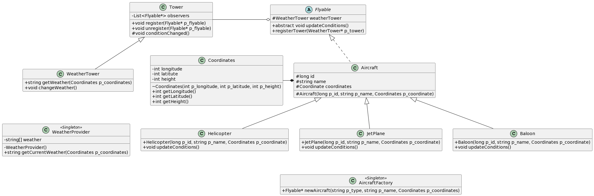

# Como ler o diagrama de classes do Avaj Launcher

**UML** significa *Unified Modeling Language*, ou Linguagem de Modelagem Unificada. Um diagrama de classes é como a planta de uma casa: mostra as partes e como elas se conectam. Não mostra, por si só, a ordem em que o programa executa nem as regras de movimento de cada aeronave.

Abra a [imagem original](avaj_uml.png) para ampliar. O [PlantUML](global.puml) descreve o diagrama em texto e ajuda a conferir nomes e símbolos. As regras da simulação estão no [enunciado](Avaj%20Launcher.pdf).

## 1. Leia uma caixa: nome, dados e operações

Comece por `Coordinates`, no meio do desenho. O topo dá o **nome da classe**. A seção do meio lista os **atributos**: `longitude`, `latitude` e `height`. Pense na classe como o modelo de uma ficha; cada objeto `Coordinates` é uma ficha preenchida com três valores. A parte inferior lista as **operações**, como o construtor que recebe esses valores e o método que devolve a altura.

Leia `+int getHeight()` da esquerda para a direita: `+` indica acesso público, `int` é o tipo do valor devolvido, `getHeight` é o nome do método e `()` indica que ele não recebe argumentos. `void`, como em `+void changeWeather()`, significa que o método não devolve um valor. Já o construtor `~Coordinates(...)` tem o mesmo nome da classe e não declara tipo de retorno.

| Símbolo | Em Java | Exemplo no desenho |
| --- | --- | --- |
| `+` | `public`: público | `Tower.register(...)` |
| `-` | `private`: interno à classe | `Tower.observers` |
| `#` | `protected`: acessível no mesmo pacote e por subclasses, conforme as regras de Java | `Aircraft.id` |
| `~` | Sem modificador: acessível no mesmo pacote | Construtor de `Coordinates` |

Na imagem, **C** marca uma classe, e **A** identifica uma classe abstrata. `Flyable` é abstrata: não se cria um `Flyable` diretamente com `new`, mas é possível criar um `JetPlane` e usá-lo onde se espera um `Flyable`. A marca `«Singleton»` em `WeatherProvider` e `AircraftFactory` indica que cada uma deve fornecer uma instância compartilhada; não é uma palavra-chave do Java.

## 2. Leia as linhas: pergunte se a classe “é” ou “tem” algo

| Símbolo na ponta | Como ler | Exemplo na imagem |
| --- | --- | --- |
| Triângulo vazio, linha contínua | **Herança**: a seta aponta para a classe mais geral. Leia “é um tipo de”. | `WeatherTower` é um tipo de `Tower`. Em Java: `class WeatherTower extends Tower`. `JetPlane` também é um tipo de `Aircraft`. |
| Losango preenchido | **Composição**: o losango fica na ponta do todo; a outra ponta representa a parte. | O losango está em `Aircraft`: a posição `Coordinates` faz parte do estado da aeronave. A aeronave **tem** uma posição, mas não **é** uma posição. |
| Losango vazio | **Agregação**: indica uma relação todo-parte mais fraca do que composição. Pela convenção, o losango marca o todo. | O desenho coloca o losango em `Flyable`, mas o atributo `Tower.observers` mostra que é a torre que mantém a lista; `Flyable.weatherTower` guarda a referência de volta à torre. |
| Triângulo vazio, linha tracejada | **Realização**: em um diagrama Java, normalmente liga uma classe à interface que ela implementa. | A seta de `Aircraft` aponta para `Flyable`, mas `Flyable` está marcado como classe abstrata e possui estado de instância. A implementação usa `Aircraft extends Flyable`, não `implements Flyable`. |

O diagrama não usa apenas sintaxe de Java: `Flyable*` representa uma referência (`Flyable` em Java), e `string` vira `String`. A imagem escreve `Baloon`; o PlantUML, o cenário e o código usam `Balloon`. Essas diferenças não representam classes distintas. Na leitura, compare o símbolo com os atributos e o enunciado antes de traduzir para código.

## 3. Siga um jato pelo desenho

1. `AircraftFactory.newAircraft(...)` devolve um `Flyable`. Para o tipo `JetPlane`, o objeto criado é um jato.
2. Siga os triângulos a partir de `JetPlane`: ele é um `Aircraft` e, na implementação Java, também é um `Flyable`.
3. O jato se registra na `WeatherTower`. A torre mantém uma `List<Flyable>` e por isso não precisa saber qual é o tipo concreto de cada inscrito.
4. Em uma rodada, a torre chama `updateConditions()`. O Java seleciona a versão do jato, que consulta o clima de sua posição e aplica a regra de movimento. Essa troca de avisos é o padrão **Observer** (observador).

Para conferir a tradução no código, compare [Tower](ro/academyplus/avaj/simulator/Tower.java), [Flyable](ro/academyplus/avaj/simulator/Flyable.java) e [JetPlane](ro/academyplus/avaj/simulator/JetPlane.java). O [guia didático de Java](guia-didatico-java.md) acompanha uma rodada completa com valores e mensagens reais.

## 4. Pratique na imagem

- **Localize `#void conditionChanged()`. A qual classe pertence? Quem pode acessá-lo? Ele devolve algo?** Pertence a `Tower`, é `protected` e não devolve valor (`void`).
- **Qual é a diferença entre as linhas que ligam `JetPlane` a `Aircraft` e `Aircraft` a `Coordinates`?** A primeira diz que um jato **é** uma aeronave; a segunda diz que uma aeronave **tem** uma posição.
- **Onde você procuraria a regra que diz quanto o jato muda de altura na neve?** No enunciado ou em `JetPlane.updateConditions()`. O diagrama mostra que o método existe, mas não descreve a regra dentro dele.