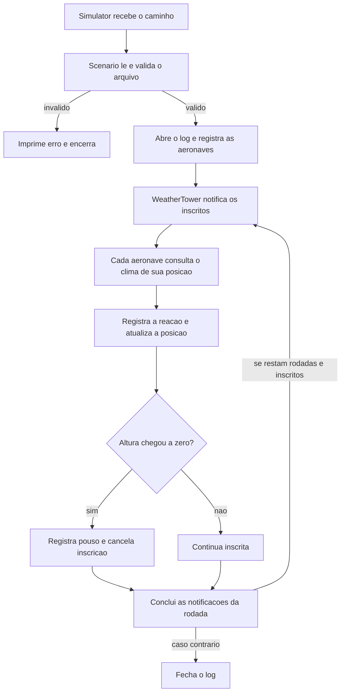

# Avaj Launcher: aprendendo Java com um simulador

Este guia parte do zero em Java. Primeiro você vai compilar e executar o programa; depois, seguir o caminho de uma aeronave desde o arquivo de entrada até o log. O [README](README.md) é a referência rápida de execução. A [análise do enunciado](analise-enunciado.md) separa os requisitos da 42 das decisões de implementação.

## 1. O que o programa faz?

Imagine uma torre que avisa as aeronaves quando chega uma nova rodada de clima. Cada aeronave pergunta como está o clima **na sua posição**, reage de acordo com o seu tipo e escreve uma mensagem. Se pousar, sai da lista da torre. O resultado é uma sequência de eventos em `simulation.txt`, não uma animação nem um modelo físico de aeroporto.

- **Cenário:** a lista de aeronaves e o número de rodadas solicitadas.
- **Rodada:** um passo da simulação, não um segundo do relógio. A estação meteorológica calcula o clima a partir da posição e do número desse passo.
- **Estado:** os dados de um objeto em determinado momento, como a posição atual de uma aeronave ou a lista de inscritos na torre.

## 2. Sua primeira execução

Você precisa de um **JDK** (*Java Development Kit*) 17 ou superior. Pense nele como a caixa de ferramentas: `javac` traduz o código-fonte, e `java` inicia a **JVM** (*Java Virtual Machine*), que executa o código traduzido. Se o terminal mostrar `command not found`, confira se o JDK está instalado e se sua pasta `bin` está no `PATH`, a lista de diretórios onde o terminal procura comandos.

No terminal Linux, a partir da raiz do workspace:

```sh
cd everton-mota/Avaj-Launcher
javac -version
java -version
find * -name '*.java' > sources.txt
javac @sources.txt
java ro.academyplus.avaj.simulator.Simulator scenario.txt
head -n 12 simulation.txt
```

1. `find` localiza os fontes `.java`. O `>` redireciona a lista para `sources.txt`; não compila nada.
2. `javac @sources.txt` lê os caminhos da lista e gera arquivos `.class`. Esses arquivos contêm **bytecode**, as instruções que a JVM entende. Eles não devem ser incluídos na entrega Git.
3. `java` recebe o nome completo da classe inicial: pacote `ro.academyplus.avaj.simulator` mais classe `Simulator`. A parte `scenario.txt` é um argumento **do programa**, que receberá o caminho do arquivo.
4. `head` mostra as primeiras linhas do log. O log fica no diretório de trabalho, mesmo que o cenário esteja em outro lugar.

O **pacote** funciona como um endereço que organiza classes e diferencia classes com o mesmo nome. Neste projeto, os pontos do endereço correspondem aos diretórios que começam em `ro/`. Por isso, execute a partir da raiz do projeto, não de dentro do diretório que contém o fonte do `Simulator`. O projeto usa apenas a biblioteca padrão do Java, sem Maven, Gradle ou dependências externas.

## 3. Java suficiente para ler o projeto

Uma **classe** é como a ficha em branco que define quais dados e ações cada objeto terá. Um **objeto** (ou **instância**) é uma ficha concreta: dois balões são da mesma classe, mas têm IDs e posições próprios.

```java
Coordinates position = new Coordinates(1, 1, 5);
int height = position.getHeight();
```

- `Coordinates` é o tipo de `position`. `new` cria o objeto e chama o **construtor**, que prepara seus dados iniciais. Este exemplo pode ser usado dentro do mesmo pacote, pois o construtor não é público.
- `position` guarda uma **referência** ao objeto, como um endereço para encontrar a ficha. A expressão `position.getHeight()` chama um **método**, uma ação que, neste caso, devolve a altura.
- `int` é um inteiro de 32 bits usado nas coordenadas e no parser. `long` é um inteiro de 64 bits, usado para IDs e para a soma do clima; `String` representa texto. `String[]` é um **array** de textos; seus índices começam em zero.
- Os **campos** guardam dados do objeto. Os campos de `Coordinates` são `private final`: ficam encapsulados na classe e são atribuídos na construção, sem alteração posterior. Para mover uma aeronave, o simulador substitui sua referência por um novo `Coordinates`.

### Visibilidade, herança e polimorfismo

| Palavra ou notação | Como ler neste projeto |
| --- | --- |
| `public` / `+` no UML | Acesso público, como `Coordinates.getHeight()`. |
| `private` / `-` | Uso interno da classe, como a lista de observadores de `Tower`. |
| `protected` / `#` | Acesso no mesmo pacote e por subclasses, respeitando as regras de Java. `Balloon` usa `coordinates`, que herda de `Aircraft`. |
| Sem modificador / `~` | Acesso dentro do mesmo pacote, como o construtor de `Coordinates`. |
| `extends` | Herança: um `Balloon` é um `Aircraft`, e um `Aircraft` é um `Flyable`. |
| `abstract` | A classe não pode ser criada diretamente com `new`. `Flyable` define `updateConditions()`, deixando a reação concreta para as subclasses. |
| `@Override` | Indica que o método substitui um método herdado. O compilador confere se a assinatura corresponde. |
| `super(...)` | Invoca o construtor da classe pai. No balão, encaminha o ID, o nome e a posição para `Aircraft`. |

**Polimorfismo** é tratar objetos diferentes pelo mesmo tipo e deixar cada um responder à sua maneira. A torre guarda uma `List<Flyable>` e chama `updateConditions()` em cada item. O Java escolhe em tempo de execução a implementação de `Balloon`, `JetPlane` ou `Helicopter`. A torre não precisa de um `if` para cada aeronave.

### Como ler a porta de entrada

```java
public static void main(String[] args)
```

`main` é o método chamado ao iniciar o programa. `static` significa que o método pertence à classe, sem precisar de um objeto `Simulator`. `void` significa que ele não devolve um valor. `args.length` conta os argumentos; `args[0]` é o primeiro. A CLI confere se há exatamente um antes de acessar o array. **CLI** é a interface de linha de comando.

## 4. Quem faz o quê?

Leia os arquivos nesta ordem para não tentar entender todas as classes de uma vez:

| Componente | Responsabilidade |
| --- | --- |
| [Simulator](ro/academyplus/avaj/simulator/Simulator.java) | Verifica os argumentos, solicita a leitura, abre o log e comanda as rodadas. |
| [Scenario](ro/academyplus/avaj/simulator/Scenario.java) | Lê e valida o arquivo, produzindo a contagem e a lista de aeronaves. É um `record`: uma forma compacta de representar dados e gerar acessores como `cycles()` e `aircraft()`. |
| [AircraftFactory](ro/academyplus/avaj/simulator/AircraftFactory.java) | Traduz nomes de tipos, como `Balloon`, em objetos e atribui IDs sequenciais às aeronaves do cenário. |
| [Tower](ro/academyplus/avaj/simulator/Tower.java) e [WeatherTower](ro/academyplus/avaj/simulator/WeatherTower.java) | A primeira controla as inscrições e dispara notificações; a segunda fornece o clima e controla a rodada atual. |
| [WeatherProvider](ro/academyplus/avaj/simulator/WeatherProvider.java) | Calcula o clima de uma posição na rodada informada. |
| [Flyable](ro/academyplus/avaj/simulator/Flyable.java) e [Aircraft](ro/academyplus/avaj/simulator/Aircraft.java) | `Flyable` define o contrato das notificações. `Aircraft` concentra identidade, posição, aplicação do movimento, mensagens e pouso. |
| [Balloon](ro/academyplus/avaj/simulator/Balloon.java), [JetPlane](ro/academyplus/avaj/simulator/JetPlane.java) e [Helicopter](ro/academyplus/avaj/simulator/Helicopter.java) | Cada classe escolhe a mensagem e o movimento para os quatro climas. |
| [Coordinates](ro/academyplus/avaj/simulator/Coordinates.java) | Guarda longitude, latitude e altura. Limita a altura à faixa de 0 a 100. |

### Três padrões e para que servem

- **Factory (fábrica):** pense num balcão que recebe um pedido pelo nome e entrega o objeto certo. `Scenario` lê `Balloon`; `AircraftFactory` decide qual construtor chamar. A leitura do arquivo não precisa conhecer os construtores de cada tipo.
- **Singleton (instância única):** `WeatherProvider` e `AircraftFactory` têm construtor privado e oferecem `getInstance()`. A mesma instância é compartilhada dentro da execução. Isso não significa que todas as aeronaves recebem o mesmo clima: cada consulta passa sua posição, e cada torre acompanha a própria rodada.
- **Observer (observador):** a torre mantém uma lista de inscritos, como uma lista de avisos. Ela difunde o aviso de mudança, não um clima único. Cada aeronave consulta o seu clima e pode cancelar a inscrição durante a chamada. Para isso, `Tower` notifica percorrendo uma cópia da lista; a remoção altera a lista original e exclui a aeronave das rodadas seguintes.

No [diagrama UML](global.puml), as relações ajudam a encontrar onde ler: herança liga os tipos de aeronave, enquanto a associação entre torre e observadores representa a lista de inscrições. Herança responde a **“é um tipo de quê?”**; associação responde a **“com quem interage?”**.

## 5. Acompanhe uma simulação à mão

O projeto inclui um [cenário maior](scenario.txt). Para estudar duas rodadas, considere este cenário como `cenario-estudo.txt`:

```text
2
Balloon B1 1 1 1
JetPlane J1 1 1 100
```

O `2` da primeira linha é o número de rodadas, não o número de aeronaves. Cada linha seguinte informa, nesta ordem, **tipo, nome, longitude, latitude e altura**. Após compilar, a chamada para esse exemplo é `java ro.academyplus.avaj.simulator.Simulator cenario-estudo.txt`.



O clima usa o resto da divisão de `longitude + latitude + altura + rodada` por `4`, com a contagem interna partindo de `0`. O resultado é o índice no array `[RAIN, FOG, SUN, SNOW]`.

| Rodada interna | Aeronave | Cálculo | Efeito |
| --- | --- | --- | --- |
| `0` | `B1`, posição `(1, 1, 1)` | Soma `3`, índice `3`: `SNOW` | A altura diminuiria em 15. É limitada a `0`, o balão pousa e cancela a inscrição. |
| `0` | `J1`, posição `(1, 1, 100)` | Soma `102`, índice `2`: `SUN` | A latitude sobe para `11`. A altura ficaria em `102`, mas permanece em `100`. |
| `1` | `J1`, posição `(1, 11, 100)` | Soma `113`, índice `1`: `FOG` | A latitude sobe para `12`. `B1` já não é notificado. |

Saída esperada no log para esse exemplo:

```text
Tower says: Balloon#B1(1) registered to weather tower.
Tower says: JetPlane#J1(2) registered to weather tower.
Balloon#B1(1): The balloon is turning into a snow globe.
Balloon#B1(1) landing.
Tower says: Balloon#B1(1) unregistered from weather tower.
JetPlane#J1(2): Clear skies and a smooth climb.
JetPlane#J1(2): The view from every seat is now the same.
```

Note que `B1` é o **nome** informado no cenário e `1` é seu **ID** atribuído pela fábrica. O clima é **determinístico**: com a mesma entrada, execuções separadas produzem a mesma sequência. As mensagens do PDF são exemplos; o algoritmo e o texto aqui são do projeto.

### Como o clima se transforma em movimento

```java
case "SUN" -> respond("Perfect light for an aerial photo.", 2, 0, 4);
```

Esse trecho está no `switch` de `Balloon.updateConditions()`. Um `switch` escolhe qual ramo executar com base no valor consultado. Os números enviados a `respond` são **variações**, não coordenadas absolutas: some 2 à longitude, mantenha a latitude e some 4 à altura. `Aircraft.respond()` escreve a mensagem, cria a nova posição e verifica se houve pouso. Os outros tipos reaproveitam esse método e mudam apenas as reações.

## 6. Erros, arquivos e testes

O parser verifica a contagem positiva, os cinco campos de cada aeronave, o tipo e os valores numéricos. Longitude e latitude devem ser positivas; altura inicial negativa é inválida. A altura inicial acima de `100` é limitada a `100`, como ocorre com `J2` no cenário fornecido. Uma aeronave que começa em `0` pousa no registro, sem esperar a primeira rodada.

Uma **exceção** é como um aviso que interrompe o fluxo normal e sobe até um ponto que sabe tratá-lo. Por exemplo, `Integer.parseInt` lança `NumberFormatException` se o valor não cabe no tipo ou não tem formato de inteiro. `Scenario` traduz isso para `InvalidScenarioException`, que traz a linha e o campo com problema. O `try` delimita o trecho que pode falhar; o `catch` trata as exceções esperadas, imprime a mensagem na saída padrão e encerra com código `1`.

O log só é aberto depois de ler toda a entrada. Assim, um erro na última linha não apaga uma simulação anterior. O arquivo de saída é aberto com um `try` com recursos (`try (...)`), que fecha o `BufferedWriter` ao sair do bloco. Um `BufferedWriter` acumula texto em memória antes de enviá-lo ao arquivo. A expressão `message -> writeLine(output, message)` é uma **lambda**: uma pequena função que a torre recebe para encaminhar cada mensagem ao log, sem precisar saber como o arquivo foi aberto.

Depois de compilar, é possível executar o [teste do modelo](tests/ro/academyplus/avaj/simulator/SimulationTest.java):

```sh
java -cp .:tests ro.academyplus.avaj.simulator.SimulationTest
```

`-cp` define o **classpath**, os lugares onde `java` procura classes. No Linux, `:` separa `.` (o projeto) de `tests` (as classes de teste). O teste fixa cada clima para verificar os movimentos sem depender de uma sequência gerada. Também confere o teto, o pouso, a continuidade da rodada e a influência das coordenadas. Não usa JUnit ou outra dependência externa.

### Exercícios de leitura

1. No exemplo de duas rodadas, troque a altura inicial de `B1` para `2`. Qual é o clima inicial? Ele pousa nessa primeira rodada? **Resposta:** soma `4`, índice `0` (`RAIN`); a chuva reduz a altura em `5`, então ele pousa.
2. Compare o ramo `SUN` do balão com o do jato. Qual eixo horizontal muda em cada caso? **Resposta:** longitude no balão e latitude no jato.
3. Imagine que uma linha válida seja seguida por `JetPlane J2 1 X 20`. Onde a execução para? **Resposta:** na leitura da latitude em `Scenario`; `Simulator` informa o erro antes de abrir o log.
4. Explique por que `Tower` não precisa importar as três classes concretas. **Resposta:** ela só depende do contrato `Flyable`; o polimorfismo seleciona a reação de cada aeronave.